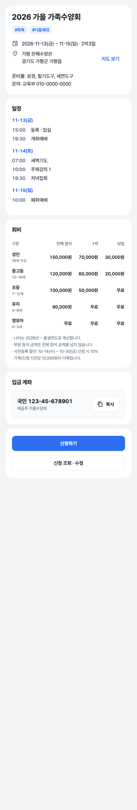
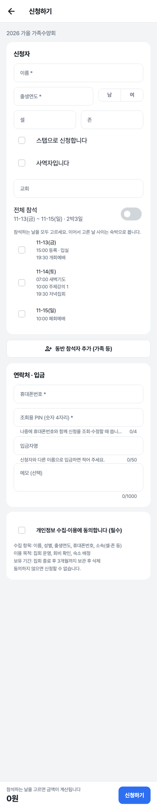
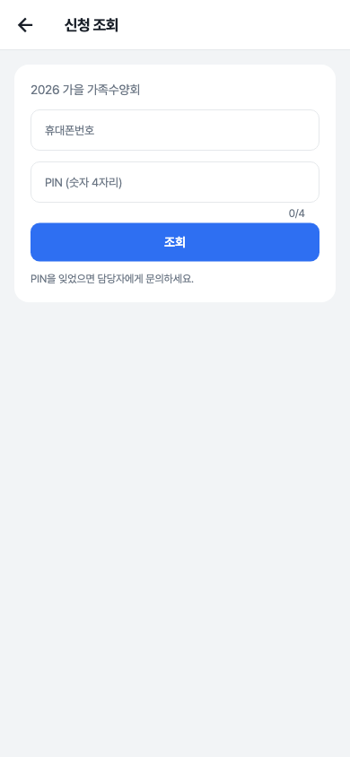
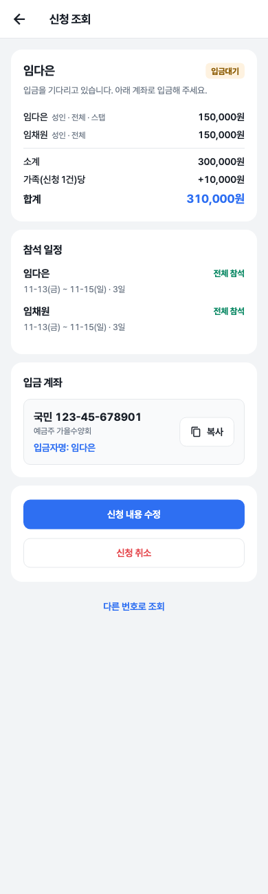
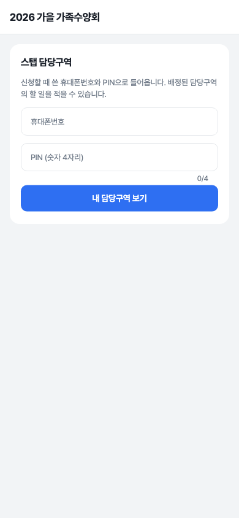
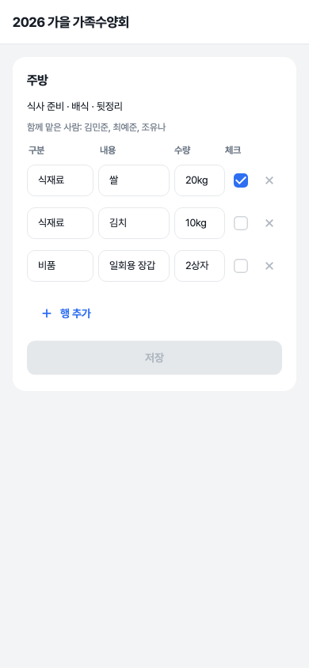

# 집회 신청 사용자 매뉴얼

> 담당자에게 받은 **신청 링크**를 휴대폰으로 엽니다. 앱 설치나 회원가입은 필요 없습니다.
> 화면의 이름·전화번호는 모두 예시입니다.

## 1. 집회 페이지 보기

링크를 열면 집회 안내가 나옵니다.

- **기간 · 장소**: [지도 보기]를 누르면 지도 앱이 열립니다.
- **일정**: 날짜별 시간표.
- **회비**: 나이별 전체 참석 / 1박 / 당일 금액. 나이는 *집회 연도 − 출생연도* 입니다. 사전등록 할인이 있으면 기간이 적혀 있습니다.
- **입금 계좌**: [복사]를 누르면 계좌번호가 복사됩니다.
- 맨 아래 **[신청하기]**, **[신청 조회 · 수정]**.

## 2. 신청하기

1. **신청자** 정보를 적습니다. `*` 표시는 꼭 적어야 하는 칸입니다.
2. 가족과 함께 오면 **[동반 참석자 추가]** 를 눌러 한 명씩 더합니다. 한 번에 가족 전체를 신청합니다.
3. **참석 일정** — 사람마다 **오는 날을 직접 고릅니다**(처음엔 아무 날도 안 골라져 있습니다).
   - 오는 날을 모두 체크합니다. 이어서 고른 날 사이는 숙박으로 계산합니다.
   - 모든 날 오면 **전체 참석**을 켜도 됩니다. 날짜를 다 골라도 전체 참석으로 계산됩니다.
   - "일정 없음"으로 표시된 날은 고를 수 없습니다.
4. **연락처 · 입금**
   - **휴대폰번호**와 **조회용 PIN(숫자 4자리)** — 나중에 조회·수정할 때 씁니다. 꼭 기억하세요.
   - **입금자명**: 신청자와 다른 이름으로 입금할 때만 적습니다.
5. 개인정보 수집·이용에 동의하고 아래 **[신청하기]**.

화면 맨 아래에 **합계 금액**이 바로 계산되어 나옵니다. 금액을 누르면 사람별 내역이 보입니다. 날짜를 안 고른 사람이 있으면 "참석하는 날을 고르면 금액이 계산됩니다"가 나옵니다.

신청이 끝나면 **입금 계좌**가 다시 나옵니다. 입금이 확인되면 신청이 **확정**됩니다.

## 3. 신청 조회 · 수정 · 취소

집회 페이지의 **[신청 조회 · 수정]** → 휴대폰번호와 PIN을 넣고 [조회].

| 상태 | 뜻 |
|---|---|
| 입금대기 | 아직 입금이 확인되지 않았습니다. 계좌로 입금해 주세요. |
| 입금확인 | 입금이 확인되어 신청이 확정되었습니다. |
| 취소 | 취소된 신청입니다. |

- **[신청 내용 수정]**: 입금대기 상태이고 신청 기간 안일 때만 됩니다. 사람을 더하거나 일정을 바꾸면 금액이 다시 계산됩니다.
- **[신청 취소]**: 입금대기 상태일 때만 됩니다. 다시 참석하려면 새로 신청해야 합니다.
- 확정된 뒤의 변경·환불은 담당자에게 문의하세요.

> PIN을 **5번 틀리면 30분 동안 잠깁니다.** PIN을 잊었으면 담당자에게 새 PIN을 받으세요.

## 4. 스탭 페이지 (담당구역을 맡은 분)

담당자에게 받은 **스탭 페이지 링크**를 엽니다.

 

1. **신청할 때 쓴 휴대폰번호와 PIN**을 넣고 [내 담당구역 보기].
2. 내가 맡은 구역과 함께 맡은 사람이 보입니다.
3. 할 일을 **구분 · 내용 · 수량**으로 적고, 끝난 일은 **체크**합니다. [행 추가]로 줄을 더하고 ✕ 로 지웁니다.
4. **[저장]** 을 눌러야 담당자 화면에 반영됩니다.

"담당구역이 없습니다"가 나오면 아직 배정 전입니다. 담당자에게 문의하세요.

## 홈스테이 가정으로 신청한 경우

신청서의 **수용 인원**에 재워 줄 수 있는 인원을 적습니다. 배정이 끝나면 **신청 조회** 화면의 **우리 집에 배정된 참석자**에서 손님 이름·연락처·묵는 기간을 볼 수 있습니다.
