# 집회관리 운영자 매뉴얼

> 운영자 웹: <https://yjchae.github.io/room-assignment/admin/> (macOS·Windows 앱도 화면은 같습니다)
> 화면의 이름·전화번호는 모두 예시입니다.

## 한눈에 보는 순서

| 순서 | 메뉴 | 할 일 |
|---|---|---|
| 1 | 집회 목록 → [새 집회] | 집회 만들기 |
| 2 | 집회 설정 | 장소·일정·회비·계좌 입력 → [신청 받기] 켜기 → **신청 링크 공지** |
| 3 | 신청·입금 | 입금 확인 → 확정 (신청이 들어오면 입금 전이라도 참석자로 자동 등록) |
| 4 | 방 관리 | 방 만들기 |
| 5 | 방배정 / 자동배정 | 참석자를 방에 넣기 |
| 6 | 현황 | 빠진 사람·빈 방 확인 |
| 7 | 담당구역 / 구역 할일 | 스탭 일 나누기 → **스탭 링크 공지** |

모든 내용은 서버에 바로 저장됩니다. 다른 운영자가 같은 집회를 열어도 같은 내용이 보입니다.
휴대폰·태블릿에서도 열립니다 → [12. 휴대폰·태블릿에서 쓰기](#12-휴대폰태블릿에서-쓰기)

---

## 0. 로그인 · 계정

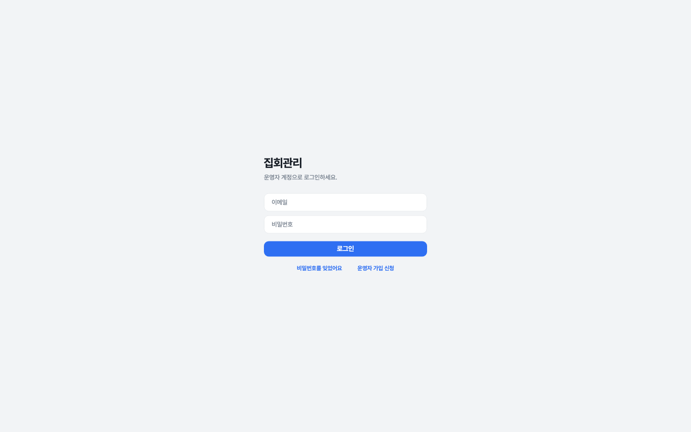

- **로그인**: 이메일·비밀번호를 넣습니다. 한 번 로그인하면 이 기기에서는 계속 유지됩니다.
- **처음 쓰는 사람**: [운영자 가입 신청] → 전체 운영자가 승인하면 로그인되고, 집회를 **하나** 만들 수 있습니다.
- **초대 링크로 들어온 사람**: 집회 담당자가 보낸 링크를 열고 [초대받은 운영자로 가입] → 로그인하면 초대받은 집회만 보입니다 (승인 없이 바로). 이미 계정이 있으면 링크를 연 화면에서 로그인만 하면 됩니다.
- **비밀번호 분실**: 이메일을 넣고 [비밀번호를 잊었어요] → 메일 링크를 **같은 브라우저**에서 열어 새 비밀번호를 정합니다.

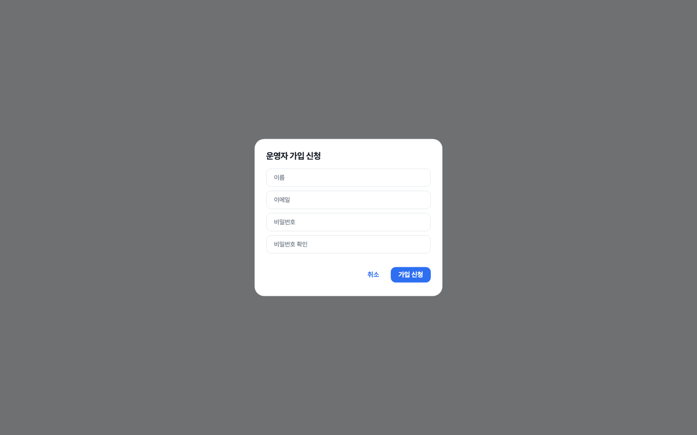

오른쪽 위 **내 이메일** 버튼을 누르면 계정 메뉴가 열립니다.

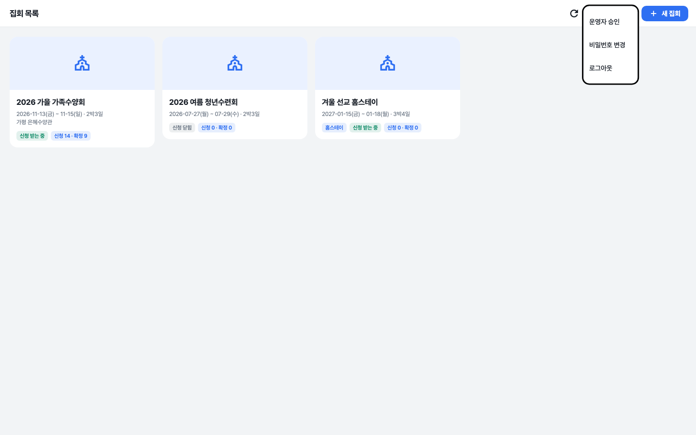

| 메뉴 | 설명 |
|---|---|
| 운영자 승인 | 전체 운영자에게만 보입니다. 가입 신청한 사람을 [승인] / [거절]. 거절해도 계정은 지우지 않고 이 앱에만 못 들어오게 합니다. |
| 비밀번호 변경 | 지금 비밀번호 확인 후 바꿉니다. |
| 로그아웃 | |

### 운영자는 세 종류

| 구분 | 되는 방법 | 할 수 있는 것 |
|---|---|---|
| **전체 운영자** | 가입으로는 될 수 없음 (서버에서 직접 지정) | 모든 집회, 새 집회 만들기·삭제, 가입 승인 |
| **승인된 가입자** | [운영자 가입 신청] → 전체 운영자 승인 | 집회 하나 만들기 + 그 집회 관리 (삭제는 못 함) |
| **집회별 운영자** | 집회의 초대 링크로 가입·로그인, 또는 이메일로 등록 | 그 집회의 설정·신청·방배정만 |

---

## 1. 집회 목록

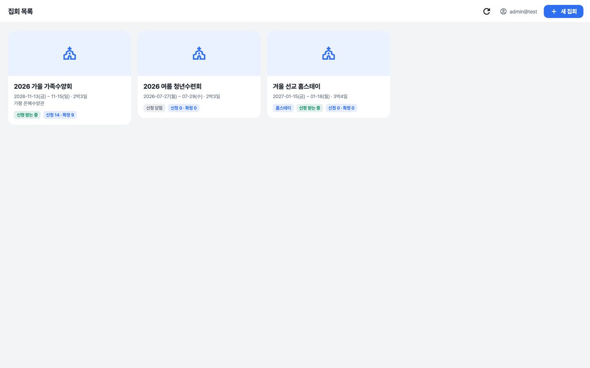

- 카드를 누르면 그 집회로 들어갑니다.
- 카드에 **신청 받는 중 / 신청 닫힘**, **신청 수 · 확정 수**가 보입니다.
- 집회별 운영자는 맡은 집회만 보이고 [새 집회] 버튼이 없습니다.

### 새 집회 만들기

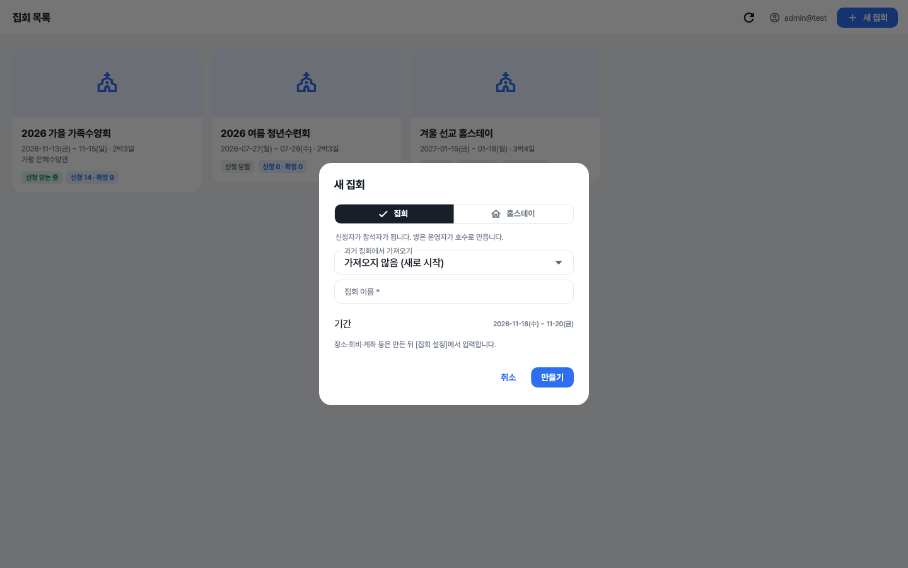

1. **구분**을 고릅니다. 만든 뒤에는 바꿀 수 없습니다.
   - **집회**: 신청한 사람이 참석자가 되고, 방은 운영자가 호수로 만듭니다.
   - **홈스테이**: 신청한 사람은 손님을 재워 줄 **가정**입니다. 신청이 들어오면 그 이름으로 방(가정)이 생깁니다. → [부록 A](#부록-a-홈스테이)
2. **과거 집회에서 가져오기**(선택): 설정·방·참석자 중 필요한 것만 체크해서 복사합니다. 참석자를 복사하면 방 배정은 풀린 채로 들어옵니다.
3. 이름과 기간을 넣고 [만들기].

---

## 2. 집회 설정

집회에 들어가면 왼쪽 메뉴가 **준비 → 배정 → 스탭** 순서로 있습니다. 첫 화면이 집회 설정입니다.

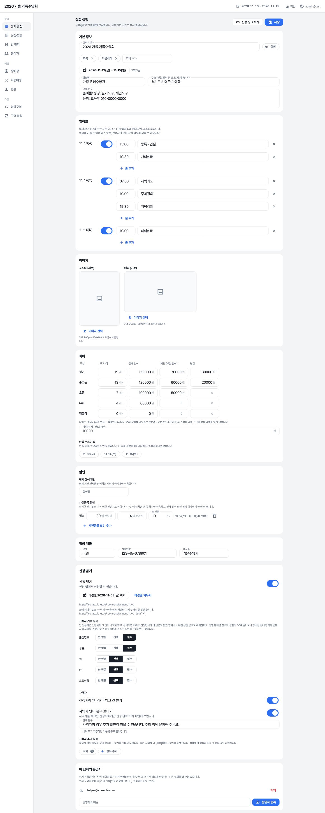

> 고친 뒤 오른쪽 위 **[저장]** 을 눌러야 신청 웹에 반영됩니다. 이미지만 고르는 즉시 올라갑니다.

| 카드 | 설명 |
|---|---|
| 기본 정보 | 이름, 주제(입력 후 Enter), 기간, 장소·주소(신청 웹의 [지도 보기]), 안내 문구 |
| 일정표 | 날짜마다 [줄 추가]로 시간·내용을 적습니다. 날짜 옆 토글을 끄면 **일정 없는 날**이 되어 신청자가 그날을 고를 수 없습니다. |
| 이미지 | 포스터(세로)·배경(가로). JPG·PNG만 됩니다(아이폰 HEIC 안 됨). 자동으로 줄여서 올립니다. |
| 회비 | 나이 구분별로 **전체 참석 / 1박당(부분 참석) / 당일** 금액. 전체 참석을 비우면 1박당 × 박수로 계산합니다. 가족(신청 1건)당 더할 금액도 여기서 정합니다. |
| 당일 무료인 날 | 고른 날 **하루만 당일로** 오면 무료입니다. 그 날을 끼고 1박이라도 묵으면 회비표대로 받습니다. |
| 할인 | **전체 참석 할인**(%) · **사전등록 할인**(집회 며칠 전부터 며칠 전까지 신청하면 몇 %). 구간이 겹치면 큰 쪽 하나만 적용합니다. |
| 입금 계좌 | 신청을 받으려면 꼭 넣어야 합니다(무료 집회 제외). |
| 신청 받기 | 토글로 신청을 열고 닫습니다. 마감일을 정하면 그날까지만 받습니다. **신청 링크**와 **스탭 페이지 링크**가 여기 보입니다. |
| 신청서 기본 항목 | 출생연도·성별·셀·존·스탭신청을 칸마다 **안 받음 / 선택 / 필수** 로 정합니다. 출생연도를 안 받으면 모두 성인 금액입니다. |
| 사역자 | "사역자" 체크 칸을 받을지, 사역자에게 보여 줄 안내 문구. |
| 신청서 추가 항목 | 교회·직분처럼 따로 받고 싶은 칸. 지우면 참석자들의 그 값도 지워집니다. |
| 이 집회의 운영자 | [초대 링크 복사]로 링크를 보내면 받은 사람이 가입·로그인해서 이 집회의 운영자가 됩니다. [링크 새로 만들기]를 누르면 예전 링크는 막힙니다. 이 앱 계정이 이미 있는 사람은 이메일로 등록해도 됩니다. 해제도 여기서 합니다. |
| 집회 삭제 | 전체 운영자만 보입니다. 설정과 신청이 모두 지워지고 되돌릴 수 없습니다. |

**신청 링크 공지**: 오른쪽 위 [신청 링크 복사] → 카톡 공지에 붙여넣습니다.

---

## 3. 신청·입금

신청을 보고, 입금을 확인해서 **확정**하는 곳입니다.

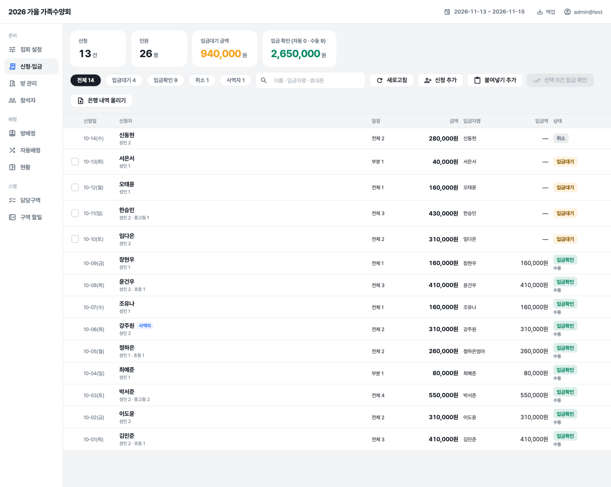

- 위 숫자: 신청 건수 · 인원 · 아직 안 들어온 금액 · 확인된 금액(자동/수동).
- 칩으로 거르기: 전체 / 입금대기 / 입금확인 / 취소 / 사역자. 검색칸은 이름·입금자명·휴대폰.
- 금액 옆 ⚠ 표시: 신청 때 보여 준 금액과 지금 계산 금액이 다르거나, 입금액이 다를 때 나옵니다.

### 입금 확인하기 (세 가지 방법)

| 방법 | 순서 |
|---|---|
| **한 건씩** | 신청을 눌러 오른쪽 상세 → [입금 확인] → 입금액·입금자명·입금일 확인 → [확정] |
| **여러 건 한 번에** | 왼쪽 체크박스로 고르고 → [선택 N건 입금 확인]. 계산 금액 그대로 오늘 날짜로 확정합니다. |
| **은행 내역으로 자동** | [은행 내역 올리기] → 은행에서 받은 입출금 내역(xls·xlsx·csv)을 고릅니다. 입금자명과 금액이 맞는 건은 미리 체크되고, 애매한 건은 이유와 함께 보여 줍니다. 확인 후 [N건 입금 확인]. 파일은 이 기기에서만 읽고 서버에 올리지 않습니다. |

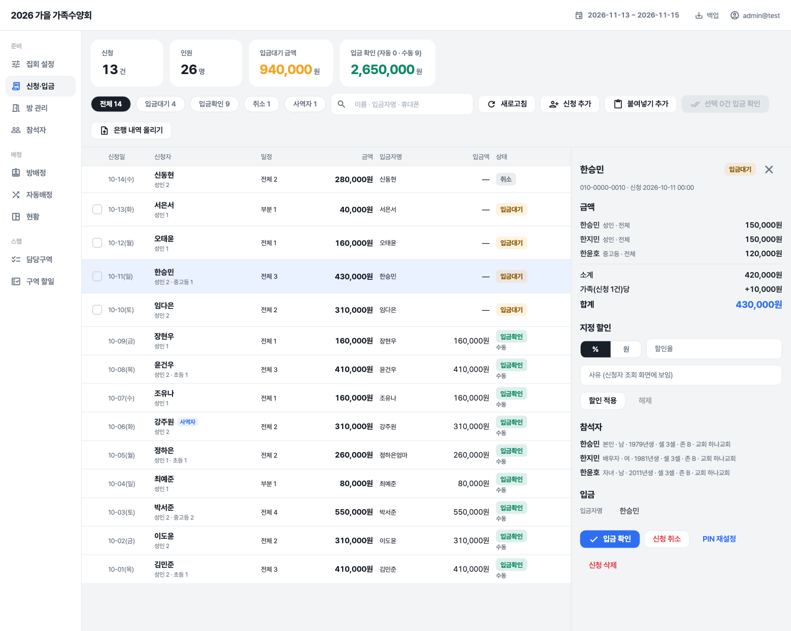

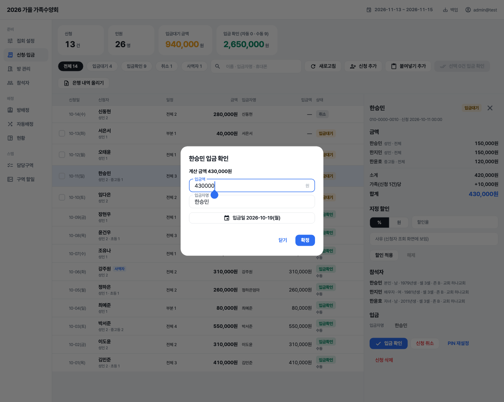

신청이 들어오면 **입금 전이라도** 그 사람들이 참석자로 자동 등록됩니다(집회를 열 때, [신청·입금]·[참석자] 화면을 열 때 맞춥니다). 입금 전인 사람은 이름 옆에 노란 **입금대기** 표시가 붙고, 방 정원에도 그대로 셉니다. 입금을 확인하면 표시가 사라집니다. 당일만 오는 사람은 방이 필요 없어 참석자에 들어가지 않습니다.

### 상세 화면의 다른 버튼

| 버튼 | 설명 |
|---|---|
| 지정 할인 | 이 신청(가족 전체)에 % 또는 원으로 할인. 사유는 신청자 조회 화면에도 보입니다. |
| 입금대기로 되돌리기 | 확정을 취소합니다. |
| 신청 취소 | 신청자 화면에 "취소"로 보입니다. 그 신청의 사람은 **방이 배정돼 있어도 참석자에서 바로 빠집니다**(창에서 누가 빠지는지 먼저 보여 줍니다). 운영자 메모를 남길 수 있습니다. |
| PIN 재설정 | 신청자가 PIN을 잊었을 때 새 4자리를 정해 알려 줍니다. 5번 틀려 잠긴 것도 풀립니다. |
| 신청 삭제 | 서버에서 완전히 지웁니다. 되돌릴 수 없습니다. |

### 운영자가 대신 신청 넣기

- **[신청 추가]**: 전화·현장 접수. 신청 웹과 같은 신청서가 뜹니다. 신청을 닫아 둔 중에도 넣을 수 있습니다. PIN은 신청자에게 알려 주세요.
- **[붙여넣기 추가]**: 엑셀 명단을 복사해 붙여넣습니다. 전화번호가 같은 사람은 한 가족으로 묶이고, 모두 입금대기로 들어갑니다. PIN은 무작위라 조회가 필요하면 [PIN 재설정]으로 알려 줍니다.

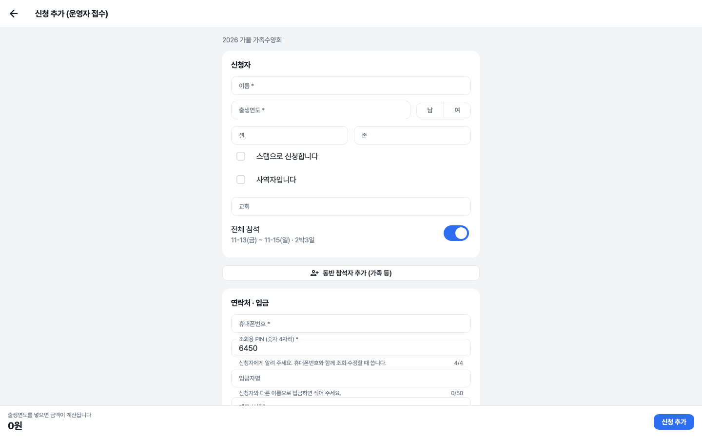

---

## 4. 방 관리

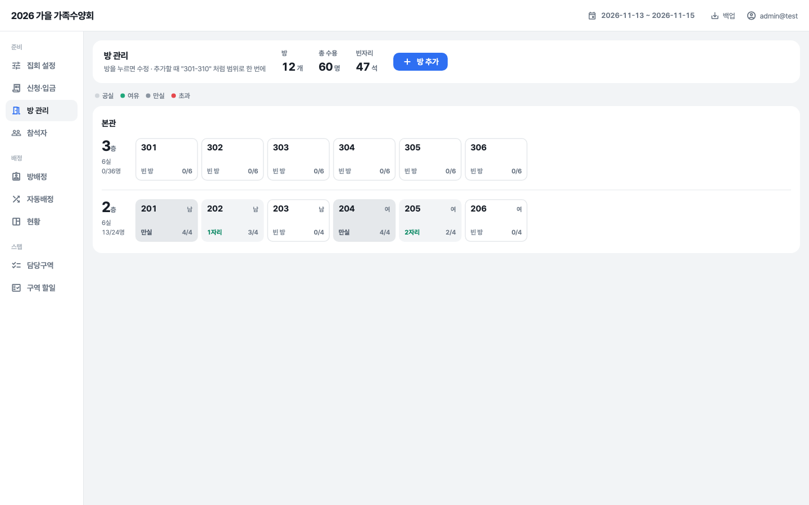

- **[방 추가]**: 호수에 `301-310` 처럼 범위를 넣으면 한 번에 만들어집니다. 건물이 여러 개면 건물 이름도 넣습니다.
- 방을 누르면 정원·성별(무관/남/여)·기타를 고치거나 삭제합니다. 삭제하면 그 방 사람은 미배정이 됩니다.
- 방 색: **공실**(흰색) · **여유**(초록 글씨) · **만실**(회색) · **초과**(빨강).
- 입금 전인 사람이 든 방은 타일에 **대기 N** 이 함께 보입니다.

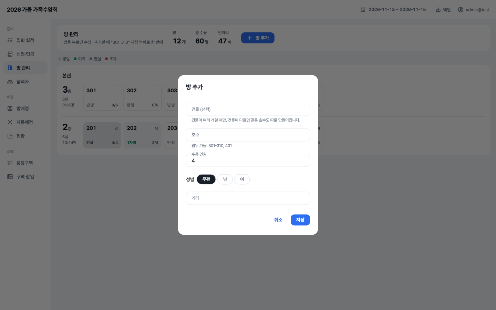

---

## 5. 참석자

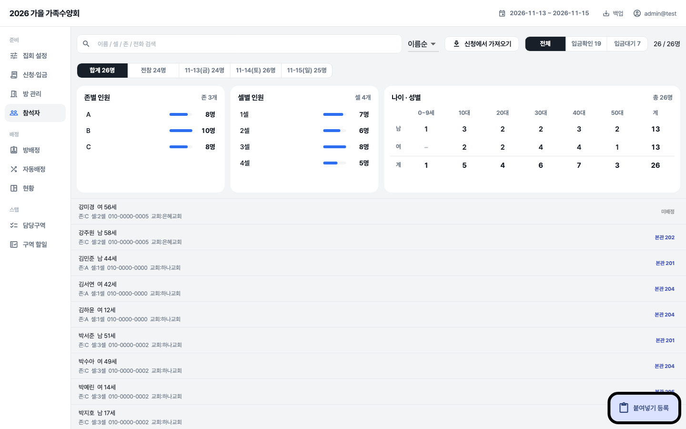

- 신청자는 자동으로 들어옵니다. **[신청에서 가져오기]** 는 한 번 더 맞추고 싶을 때 누릅니다(취소되지 않은 신청은 넣고, 취소된 신청의 사람은 뺍니다). 여러 번 눌러도 중복되지 않습니다. 운영자가 직접 고친 사람이 있으면 어느 쪽을 쓸지 물어봅니다.
- 오른쪽 위 **[전체 | 입금확인 | 입금대기]** 로 입금 상태별로 봅니다.
- 위쪽 칩: **합계 / 전참(모든 날 참석) / 날짜별 인원**. 날짜를 누르면 그날 오는 사람(당일 포함)만 셉니다 — 식수 인원 확인에 씁니다.
- 존·셀·나이·성별 통계: 칸을 누르면 그 사람들만 아래 목록에 남습니다.
- 사람을 누르면 수정 창: 이름·성별·나이·연락처·셀·존·체크인/체크아웃, **기간 나누기**(중간부터 다른 방으로), 추가 항목.
- **[붙여넣기 등록]**: 엑셀 명단을 바로 참석자로 넣습니다(신청을 거치지 않음).
- 백업 메뉴의 **참석자 CSV**로 엑셀 명단을 내려받을 수 있습니다.

---

## 6. 방배정

왼쪽에서 **사람을 고르고**, 오른쪽에서 **방을 고른 뒤** 위의 파란 버튼을 누릅니다.

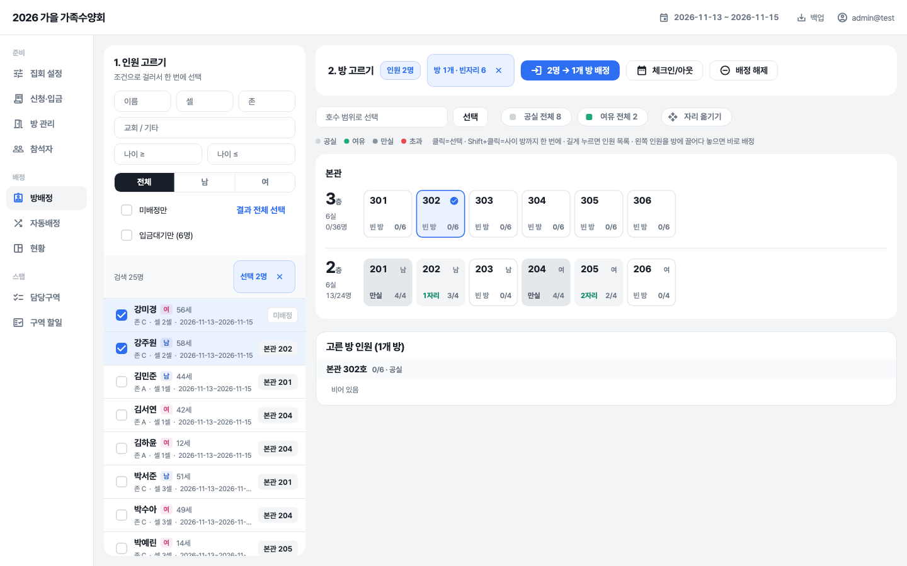

1. **인원 고르기**: 이름·셀·존·교회·나이·성별로 거르고 체크합니다. [결과 전체 선택]으로 한 번에 고를 수 있고, [미배정만]을 켜면 아직 방이 없는 사람만, [입금대기만]을 켜면 입금 전인 사람만 보입니다.
2. **방 고르기**: 방을 누릅니다. Shift+클릭하면 사이 방까지 한 번에, `301-304`처럼 범위로도 고를 수 있습니다. [공실 전체]·[여유 전체]도 있습니다.
3. **[N명 → N개 방 배정]**: 어느 방에 몇 명이 들어가는지 보여 주고 확인을 받습니다. 자리가 모자라면 "들어가는 만큼만 / 초과해서 전부" 중 고릅니다.

그 밖에

- **끌어다 놓기**: 왼쪽 사람을 방 타일에 끌어다 놓으면 바로 배정됩니다.
- **[체크인/아웃]**: 고른 사람의 묵는 날짜를 바꿉니다.
- **[배정 해제]**: 고른 사람을 미배정으로 되돌립니다.
- **[자리 옮기기]**: 방 타일을 끌어서 실제 건물 배치처럼 놓습니다. [배치 초기화]로 호수 순으로 돌아갑니다.
- 아래 **고른 방 인원**에서 사람별로 배정을 풀 수 있습니다.

---

## 7. 자동배정

미배정인 사람만 규칙대로 채웁니다. **미리보기 → 적용** 두 단계라 바로 바뀌지 않습니다.

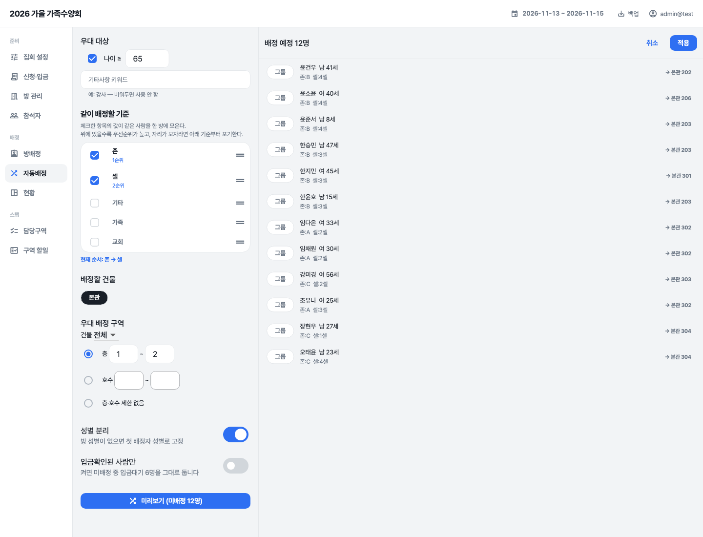

| 규칙 | 설명 |
|---|---|
| 우대 대상 | 나이 ○세 이상 또는 기타사항 키워드(예: 강사). 먼저 배정합니다. |
| 같이 배정할 기준 | 체크한 항목(존·셀·가족·교회…)이 같은 사람을 한 방에. **위에 있을수록 우선**이고, ≡ 를 끌어 순서를 바꿉니다. 자리가 모자라면 아래 기준부터 포기합니다. |
| 배정할 건물 | 건물이 여러 개일 때 넣을 건물만 고릅니다. |
| 우대 배정 구역 | 우대 대상을 넣을 층·호수 (예: 1~2층). |
| 성별 분리 | 방 성별을 지킵니다. 성별이 없는 방은 첫 배정자 성별로 고정됩니다. |
| 입금확인된 사람만 | 켜면 입금대기인 사람은 배정하지 않고 그대로 둡니다. |

[미리보기] → 오른쪽 결과 확인 → [적용]. "자리 없음"으로 나온 사람은 방이 모자란 것이니 방을 늘리거나 손으로 넣습니다.

> 자동배정은 휴대폰에서는 안 됩니다. 태블릿·PC 에서 하세요.

---

## 8. 현황

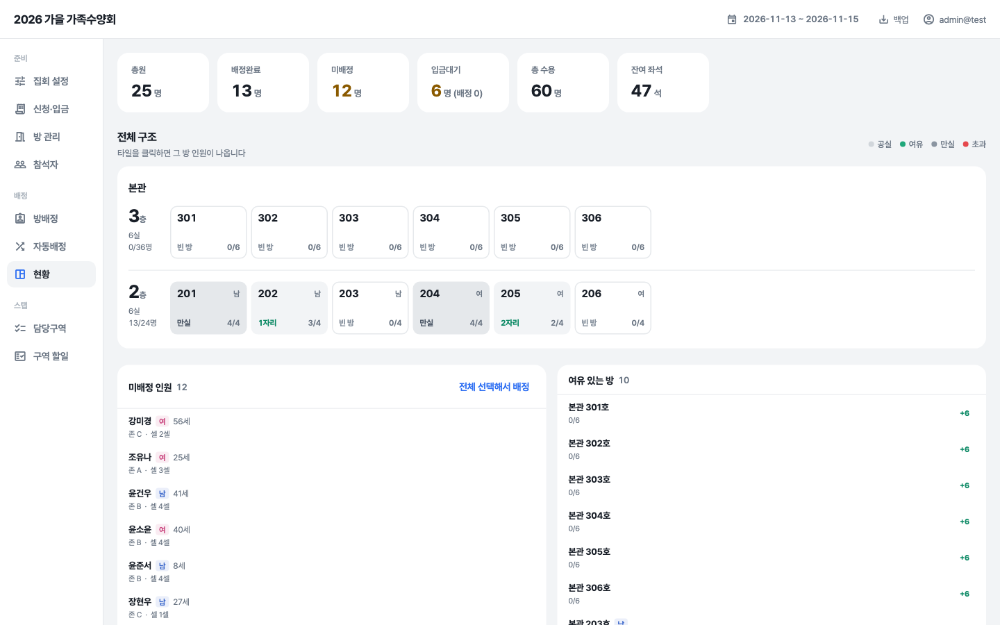

- 총원 · 배정완료 · 미배정 · **입금대기**(그중 방에 배정된 수) · 총 수용 · 잔여 좌석을 한눈에 봅니다.
- 방 타일을 누르면 그 방 사람이 나옵니다.
- **미배정 인원** 목록의 [전체 선택해서 배정]을 누르면 그 사람들을 고른 채 방배정 화면으로 넘어갑니다.
- **여유 있는 방** 목록으로 빈자리를 찾습니다.

---

## 9. 담당구역

스탭이 맡을 일(주방·차량·등록대…)을 만들고 사람을 붙입니다.

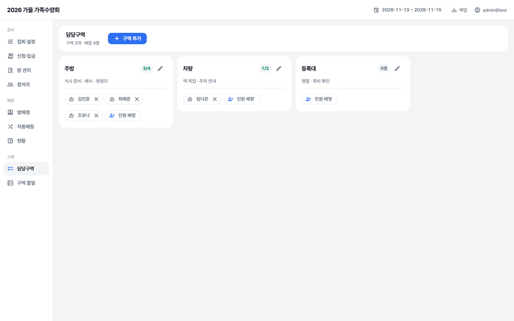

- **[구역 추가]**: 구역 이름, 필요 인원(선택), 해야 할 일.
- **[인원 배정]**: 참석자 중에서 고릅니다. [스탭만]을 켜면 신청서에서 "스탭으로 신청"한 사람만 보입니다. 한 사람이 여러 구역을 맡아도 되고, 이미 맡은 구역이 옆에 적힙니다.
- 이름 옆 ✕ 로 빼고, ✎ 로 구역을 고치거나 지웁니다.

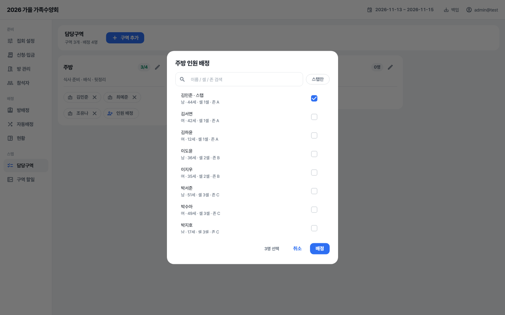

> 스탭신청 칸은 [집회 설정 → 신청서 기본 항목]에서 켜야 신청서에 나옵니다.

---

## 10. 구역 할일

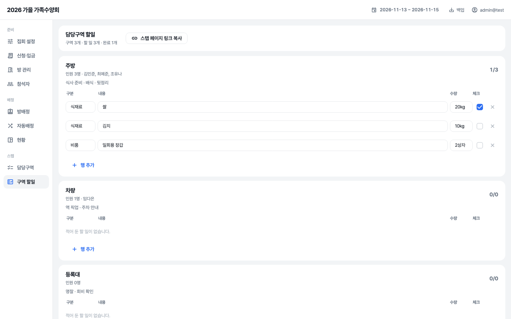

- 스탭이 스탭 페이지에서 적은 **구분 · 내용 · 수량 · 체크** 표가 구역별로 모입니다. 운영자도 여기서 바로 고칠 수 있습니다.
- **[스탭 페이지 링크 복사]** → 담당구역을 맡은 사람들에게 보냅니다. 스탭은 신청할 때 쓴 휴대폰번호+PIN으로 들어와 **자기 구역만** 봅니다.

---

## 11. 백업 (오른쪽 위 [백업])

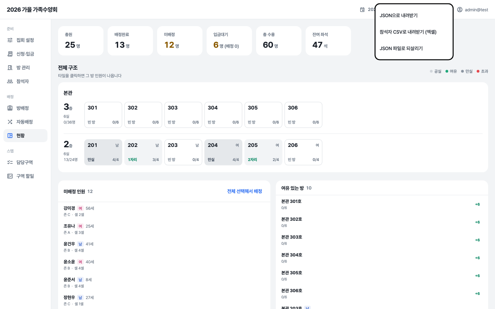

| 메뉴 | 설명 |
|---|---|
| JSON으로 내려받기 | 방·참석자·배정·담당구역 전체. 인터넷이 끊겨도 됩니다. |
| 참석자 CSV로 내려받기 | 엑셀에서 여는 참석자 명단(방·일정 포함). |
| JSON 파일로 되살리기 | 지금 방배정을 파일 내용으로 **통째로 바꿉니다**. 다른 기기에도 바로 반영되고 되돌릴 수 없습니다. |

---

## 12. 휴대폰·태블릿에서 쓰기

현장(접수대·숙소)에서 휴대폰으로 운영자 웹을 열어도 됩니다. 기능은 같고 배치만 바뀝니다.

| 화면 | 휴대폰에서 |
|---|---|
| 메뉴 | 왼쪽 위 ☰ 를 누르면 메뉴가 열립니다. 맨 위에 집회 이름이 있습니다. 태블릿은 아이콘만 있는 좁은 메뉴입니다. |
| 백업·계정 | 앱바 오른쪽 아이콘으로 엽니다. |
| 신청·입금 | 신청이 두 줄 카드로 보입니다. [새로고침]·[신청 추가]·[붙여넣기]·[은행 내역]은 ⋮ 메뉴 안에 있습니다. 신청을 누르면 상세가 전체 화면으로 열립니다. |
| 방 보드 | [목록 \| 격자] 로 보기를 바꿉니다. 휴대폰은 **목록**이 기본입니다. 방 자리 옮기기는 태블릿·PC 에서만 됩니다. |
| 방배정 | **인원 고르기 → 방 고르기** 두 단계로 나뉩니다. 사람을 고르고 [N명 · 방 고르기]를 누른 뒤 방을 누릅니다. |
| 자동배정 | 휴대폰에서는 안 됩니다. |

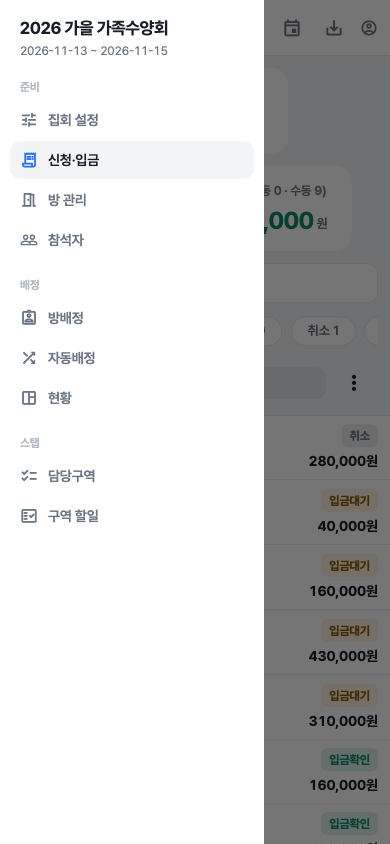 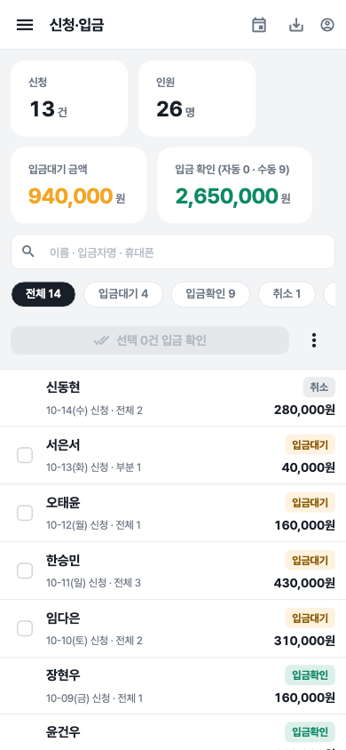 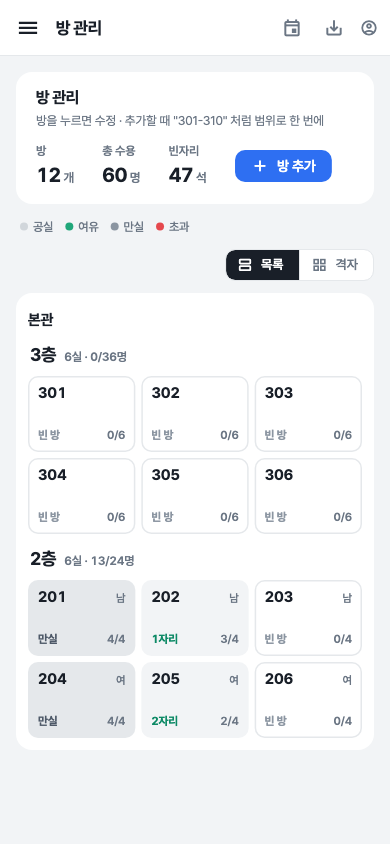

---

## 부록 A. 홈스테이

홈스테이 집회는 메뉴 이름이 **방 관리 → 가정 관리**, **방배정 → 가정 배정**으로 바뀝니다.

1. 신청서에 **수용 인원** 항목이 자동으로 붙습니다. 가정이 신청합니다.
2. 신청이 들어오면(입금대기 포함) 신청자 이름으로 **가정(방)** 이 생깁니다. 확정 전인 가정에는 **대기** 표시가 붙습니다. 한 번 더 맞추려면 [가정 관리 → 신청에서 가져오기]. 신청을 취소하면 그 가정은 지워지고, 배정돼 있던 손님은 미배정으로 돌아갑니다.
3. 재울 손님(참석자)은 [참석자 → 참석자 추가 / 붙여넣기 등록]으로 운영자가 직접 넣습니다.
4. [가정 배정]에서 가정을 고르면 그 가정이 신청한 날이 보이고, **전체 기간** 또는 **이 기간만** 배정할 수 있습니다. 남은 기간은 미배정으로 남아 다른 집에 넣을 수 있습니다.
5. 가정은 신청 조회 화면에서 **우리 집에 배정된 참석자**와 연락처를 봅니다.

## 부록 B. 이럴 땐

| 상황 | 해결 |
|---|---|
| 화면 위에 빨간 경고 줄 | 저장이 안 됐거나 다른 운영자와 동시에 고쳤습니다. 서버 내용을 다시 읽으니 확인 후 다시 고치세요. |
| 신청자가 "PIN이 맞지 않다" | [신청·입금 → 상세 → PIN 재설정]. 5번 틀리면 30분 잠기는데 이것도 풀립니다. |
| 참석자 성별이 "-" | 신청서에서 성별을 선택 항목으로 두고 비운 경우입니다. 참석자에서 채우세요. |
| 신청서 금액과 계산 금액이 다름(⚠) | 신청 뒤 회비 설정이 바뀐 경우가 대부분입니다. 상세에서 금액 내역을 확인하고 입금액으로 확정하면 됩니다. |
| 신청 웹에 "지금은 신청을 받지 않습니다" | [집회 설정 → 신청 받기] 토글과 마감일을 확인하고 [저장]. |

---

스크린샷 다시 찍기: `flutter test --update-goldens tool/manual/shots_test.dart`
